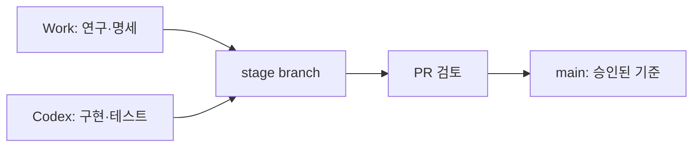

# Work–Codex–Git 협업 운영안

## 권장 구조

GitHub 저장소를 단일 기준 저장소로 두고 Work와 Codex가 같은 branch 규칙과 파일 계약을 사용한다.



## 가장 안전한 운용 방식

1. 사용자 PC에 GitHub 저장소를 clone한다.
2. Codex에서 저장소 루트를 연다. `AGENTS.md`와 `.codex/` 설정은 저장소에 체크인한다.
3. 단계마다 `research/phase-N` 또는 `phase-N` branch를 만든다.
4. Work는 연구 결과를 대화에만 남기지 않고 `docs/stages/`, `configs/`, `experiments/`, 작은 `artifacts/`에 쓴다.
5. Codex는 같은 branch에서 handoff를 읽고 구현·테스트한다.
6. 결과는 PR로 검토한 뒤 main에 merge한다.

Codex 데스크톱 로컬 환경은 `.codex` 설정을 저장소에 공유할 수 있고, Git stage/commit/push/PR 기능을 제공한다. 다만 이 현재 Work 작업공간은 실제 사용자 PC clone이 아니라 scratch이며 `.git`도 비어 있다. 따라서 지금 만든 파일이 사용자의 GitHub에 자동 반영된 상태는 아니다.

## “다운로드 없이 자동으로 읽게 하기”의 조건

가능한 방법은 두 가지다.

### A. 같은 로컬 checkout 사용

Work가 실제 같은 로컬 폴더에 쓰기 가능한 환경이라면 저장 즉시 Codex가 읽을 수 있다. Git commit/push는 Codex 또는 사용자가 수행한다. 로컬 폴더를 공유하지 않는 Work 세션에는 적용되지 않는다.

### B. GitHub 연결을 통한 branch/PR 전달

Work가 GitHub 저장소 쓰기 권한을 가진 연결 환경이면 단계 종료 때 전용 branch에 문서·설정·코드를 기록하고 PR을 만들 수 있다. Codex는 그 branch 또는 PR을 열어 이어받는다. 저장소 이름과 권한이 확인되기 전에는 자동 쓰기를 가정하면 안 된다.

완전 무인 push보다는 아래 정책을 권장한다.

- Work는 `work/phase-N-spec` branch에 연구 명세를 커밋
- Codex는 `codex/phase-N-implementation` branch에서 구현
- main 반영은 PR 검토 후 수행
- protected OOS와 Raw 데이터는 어떤 branch에도 올리지 않음
- 외부 저장소 쓰기는 정확한 repo/branch를 확인한 뒤 수행

## 단계 종료 시 Work 지침

```text
이 단계의 지속 산출물을 대화에만 남기지 말고 현재 저장소에 기록한다.
docs/stages/phase_N_spec.md에는 연구 결정, 입력/출력, 불변조건,
Codex Handoff, 테스트와 완료 조건을 작성한다.
configs/에는 동결 설정, experiments/registry.csv에는 사전 등록과 결과,
artifacts/phaseN에는 작은 요약·감사·manifest만 기록한다.
Raw/대형 데이터와 protected OOS는 Git에 넣지 않는다.
새 문서와 보고서는 한글로 작성한다.
외부 push 또는 PR은 정확한 저장소와 branch를 확인한 뒤 수행한다.
```

## Git 추적 권장/제외

| Git 추적 | Git 제외 |
|---|---|
| `AGENTS.md`, `README.md`, `docs/` | `work/`, `upload/` |
| `src/`, `tests/`, `scripts/` | `data/processed/`, `data/sealed/` |
| `configs/`, `experiments/registry.csv` | Raw 분봉, ZIP, Parquet/DuckDB 대형 파일 |
| 작은 summary CSV/JSON과 manifest/hash | 대형 원장, cache, credential, API key |

권장 `.gitignore` 핵심 항목:

```gitignore
__pycache__/
*.py[cod]
.pytest_cache/
.venv/
.env
work/
upload/
data/processed/
data/sealed/
*.zip
*.parquet
*.duckdb
```

작은 실험 요약은 `artifacts/` 전체를 제외하지 말고 파일 크기 기준과 manifest 정책으로 선별한다.
